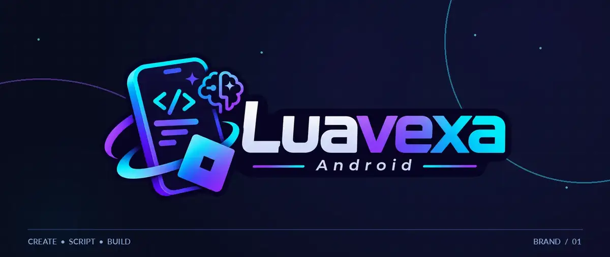
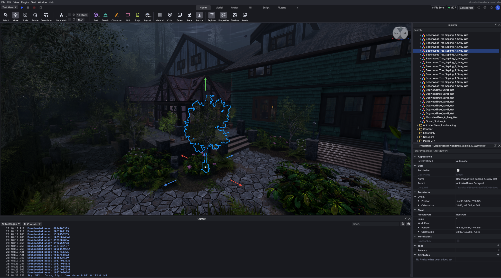

<div align="center">
  

  <h1>Luavexa Android</h1>
  <p><strong>Build worlds. Write Luau. Bring your ideas to life — anywhere.</strong></p>
  <p>Native Roblox-compatible editing on Android, with an AI-first development experience in progress.</p>

  <p>
    
    
    
    
  </p>

  [**Explore features**](#-the-editor) · [**AI roadmap**](#-the-luavexa-vision) · [**Android build**](#-build-on-android) · [**Português**](README.pt-BR.md)
</div>

---

## ✨ Make something extraordinary

**Luavexa** is an independent, Android-focused project built on top of the open-source [rustudio](https://github.com/rippelz/rustudio) editor and the [rustudio Android fork](https://github.com/TouseefX/rustudio-android).

Our goal is a **mobile development environment where an AI assistant can understand your place, consult trusted Roblox/Luau documentation, and eventually make reviewable changes through MCP tools**. You should be able to design, script, inspect, and test a project without having to switch to a desktop.

> [!IMPORTANT]
> **Development status:** The underlying editor and its MCP server come from upstream. Luavexa's dedicated AI chat, skill routing, reference retrieval, and agent actions are **planned/in prototyping**, not finished features of the APK in this repository. No production AI integration is being claimed here.

## 🛠️ The editor

The fork currently inherits these capabilities from its upstream codebase. Some games and APIs are not yet fully compatible; see [engine gaps](docs/ENGINE-GAPS.md).

| Workspace | What you can work with |
| :-- | :-- |
| 🧱 **World editor** | Explorer, Properties, transforms, terrain, models and assets |
| 💻 **Luau scripts** | Script tabs and the native Luau runtime |
| 🎮 **Play mode** | Client/server test sessions, input, physics and GUIs |
| 📁 **Projects** | `.rbxl`, `.rbxlx`, `.rbxm`, `.rbxmx` and Rojo-style folders |
| 🔌 **Tooling** | Studio plugins, file synchronization, profiler and output |
| 🧩 **MCP foundation** | The upstream server exposes project inspection, editing and test tools |

<div align="center">
  
  <br />
  <sub>Editor screenshot from the upstream project. Luavexa's branded UI and AI panel are in development.</sub>
</div>

## 🧠 The Luavexa vision

<div align="center">
  <strong>Understand → Plan → Edit → Test → Review</strong>
</div>

| Component | What it will do | Status |
| :-- | :-- | :-- |
| **MCP bridge** | Connect the assistant to the existing editor tools | 🟠 Read-only integration prototype |
| **Specialized skills** | Luau, mobile UI, gameplay, debugging, security and VFX workflows | 🟠 Prototype |
| **Reference library** | Retrieve relevant, current documentation instead of guessing APIs | 🔵 Planned |
| **Agent chat** | Turn natural-language requests into safe, explainable operations | 🔵 Planned |
| **Project-aware context** | Read only the relevant scripts and objects, with project-specific notes | 🔵 Planned |
| **Review & rollback** | Preview writes, require approval and make it easy to undo | 🔵 Planned |

### A future workflow

> “Build a mobile-friendly stamina HUD, create the supporting Luau scripts and check the Output for errors.”

The intended flow is to select relevant skills, inspect the open place through MCP, propose an implementation, request approval for changes, and verify the result. **This is a design target, not a feature available today.**

## 📱 Build on Android

The Android application uses the native Rust workspace and `xbuild`. See the upstream [Android build guide](docs/ANDROID.md) for prerequisites, Android SDK/NDK, graphics drivers and device troubleshooting.

```bash
# From a checkout of this repository, with the Android toolchain configured:
x build -p rustudio-android --platform android --arch arm64 --format apk --release
```

The existing [Android GitHub Actions workflow](.github/workflows/android.yml) also builds APK artifacts when enabled. Look under **Actions → Luavexa Android → Artifacts** after a successful run. The default Alpha artifact is `luavexa-arm64-release.apk`. **Do not treat an untested build as a production release.**

> [!CAUTION]
> **Aurora 0.1.1 candidate:** the Android package ID is `dev.luavexa.studio`, separate from the older `dev.rustudio.studio`. The new installation does **not** automatically migrate previous app data, project files, settings or sessions. Export/back up projects and keep the old app until they are verified. Never share Roblox session cookies, MCP bearer tokens, or AI API keys. See the [debug and migration guide](docs/LUAVEXA-0.1.1-DIAGNOSTICS.md).

## 🎨 Brand identity

The new Luavexa emblem and artwork are located in [`assets/branding/`](assets/branding/); the Android icon is in [`assets/icons/luavexa-512.png`](assets/icons/luavexa-512.png). Explore the [brand guide](docs/BRAND_GUIDE.md) for color tokens, asset usage and credits.

## 🧭 Development principles

1. **Mobile-first:** touch-friendly UX and reasonable memory and performance targets.
2. **Grounded AI:** use documented APIs and acknowledge editor/engine limitations.
3. **User control:** show diffs and ask before writes, publishing or live Team Create edits.
4. **Respect the project:** preserve source licenses, honor creators, and never expose account credentials.

## 🤝 Credits and licensing

Luavexa is based on [rustudio by rippelz and contributors](https://github.com/rippelz/rustudio) and [TouseefX's Android fork](https://github.com/TouseefX/rustudio-android). We appreciate the tremendous work behind the editor, its engine, and Android support.

The code retains the repository's dual **[MIT](LICENSE-MIT) / [Apache-2.0](LICENSE-APACHE)** licensing, subject to third-party components' own licenses. New Luavexa artwork was prepared for this fork; see [brand guide](docs/BRAND_GUIDE.md).

Luavexa is an **independent community project**, not affiliated with or endorsed by Roblox Corporation. Roblox and Roblox Studio are trademarks of Roblox Corporation.

<div align="center">
  <sub>Made for creators who don't want their ideas limited by a screen size.</sub>
</div>