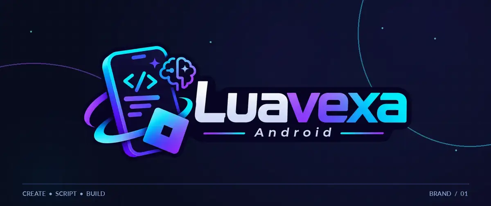

<div align="center">
  
  <h1>Luavexa Android</h1>
  <p><strong>Crie mundos. Programe em Luau. Desenvolva de onde estiver.</strong></p>
  <p>Editor nativo para Android, com uma experiência de desenvolvimento assistido por IA em construção.</p>
  <p><a href="README.md">🇺🇸 English</a> · <a href="#-recursos">Recursos</a> · <a href="#-inteligência-artificial">Roteiro de IA</a> · <a href="#-compilação-android">Compilação</a></p>
</div>

---

## ✨ Sobre o projeto

**Luavexa** é um projeto independente, focado em Android, baseado no editor open source [rustudio](https://github.com/rippelz/rustudio) e no [fork Android de TouseefX](https://github.com/TouseefX/rustudio-android).

Nosso objetivo é transformar a criação de jogos Roblox no celular: trabalhar com objetos e scripts, executar testes e, futuramente, contar com uma IA especializada que utilize **MCP, skills e referências técnicas** para ajudar no desenvolvimento.

> [!IMPORTANT]
> **Estado atual:** as ferramentas de edição e o servidor MCP vêm do projeto original. O chat com IA, o carregamento inteligente de referências e a execução de mudanças pelo agente **ainda não estão integrados ao aplicativo final**. Existem protótipos separados em desenvolvimento.

## 🛠️ Recursos

| Recurso herdado do projeto original | Descrição |
| :-- | :-- |
| 🧱 Editor de mundos | Explorer, Properties, transformações e terreno |
| 💻 Scripts Luau | Abas de código e execução na VM Luau |
| 🎮 Testes | Modo Play com cliente, servidor, física e interfaces |
| 📁 Projetos | Arquivos `.rbxl`, `.rbxlx`, `.rbxm`, `.rbxmx` e projetos Rojo |
| 🔌 MCP | Ferramentas de leitura, edição e teste disponibilizadas pelo editor |

O Rustudio ainda não reproduz perfeitamente todas as APIs da Roblox. Consulte as [limitações técnicas](docs/ENGINE-GAPS.md).

## 🧠 Inteligência artificial

A arquitetura planejada funciona em cinco passos:

**Entender o pedido → Consultar skills e referências → Preparar mudanças → Pedir aprovação → Testar e verificar.**

| Sistema | Estado |
| :-- | :-- |
| Cliente MCP de leitura | Protótipo separado |
| Skills de Luau, GUI, segurança e depuração | Protótipo separado |
| Busca inteligente na documentação | Planejado |
| Chat com modelos de IA | Planejado |
| Memória por projeto e revisão de alterações | Planejado |

**Exemplo de objetivo futuro:** “Crie uma HUD de stamina para celular, gere os scripts e confira os erros no Output.”

## 📱 Compilação Android

Siga o [guia oficial de compilação Android do projeto base](docs/ANDROID.md). Com Rust, SDK/NDK e xbuild preparados:

```bash
x build -p rustudio-android --platform android --arch arm64 --format apk --release
```

O workflow [Android no GitHub Actions](.github/workflows/android.yml) também pode gerar um APK de teste quando estiver habilitado. **A compilação e os testes devem ser concluídos antes de recomendar a instalação.**

> [!CAUTION]
> O identificador Android ainda é `dev.rustudio.studio`, portanto pode existir conflito de assinatura com outra instalação. Faça backup dos projetos antes de testar. Não compartilhe cookies de sessão Roblox, tokens MCP ou chaves de API.

## 🎨 Identidade visual

Confira a [logo](assets/branding/luavexa-logo.png), o [ícone Android](assets/icons/luavexa-512.png) e o [guia de identidade](docs/BRAND_GUIDE.md).

## 🤝 Créditos e licenças

A base técnica é derivada de [rippelz/rustudio](https://github.com/rippelz/rustudio) e [TouseefX/rustudio-android](https://github.com/TouseefX/rustudio-android). As licenças de código existentes **MIT ou Apache-2.0** são preservadas; dependências de terceiros mantêm suas respectivas licenças.

Luavexa é independente e não possui vínculo oficial com a Roblox Corporation. Roblox e Roblox Studio são marcas da Roblox Corporation.

<div align="center">
  <sub>Da ideia ao jogo — diretamente do seu celular.</sub>
</div>